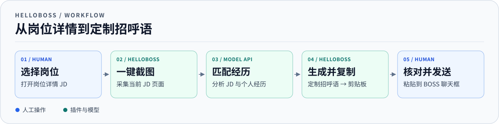

# HelloBoss

HelloBoss 是一个为 BOSS 直聘求职者设计的 Chrome 侧栏扩展。你挑岗位，插件根据 JD 和你的经历写第一条招呼语，你核对后发送。

## 为什么做 HelloBoss

连续看岗位时，每遇到一个想投的职位，都要读一遍 JD、从自己的经历里找匹配点，再把这些信息写成简短的开场白。通用话术发得快，却很难让招聘者一眼看出你为什么适合这个岗位。逐条手写更具体，但同样的整理工作会反复做。

HelloBoss 把截图、匹配经历、起草和复制串成一次点击，让你把时间留给选岗位和判断文案是否合适。

## 人机协作流程



1. **你选岗位。** 在 BOSS 直聘挑选想联系的职位，打开岗位详情（JD）页面。
2. **插件一键截图。** 在侧栏点击「一键截屏并复制招呼语」，采集当前岗位详情。
3. **大模型 API 分析并起草。** 插件把截图、个人经历和风格说明传给你配置的视觉模型。模型分析岗位要求，挑选相关经历，生成针对当前岗位的招呼语。正文显示在侧栏，并自动复制到剪贴板。
4. **你核对并发送。** 确认正文准确，必要时在侧栏编辑并重新复制。将正文粘贴到 BOSS 聊天框，由你点击发送。


## 安装与使用

1. 下载或克隆仓库。在 Chrome 的扩展管理页面开启开发者模式，点击「加载已解压的扩展程序」，选择仓库里的 `extension` 目录。需要 Chrome 116 或更新版本。
2. 打开岗位详情页，点击工具栏的 HelloBoss 图标。展开「配置」，选择供应商并填写支持图片输入的模型、HTTPS Base URL 和 API Key。
3. 填写或导入个人经历和风格 Markdown。可用 [经历模板](examples/experience.md) 和 [风格模板](examples/style.md) 起步。
4. 点击「一键截屏并复制招呼语」。检查生成正文，再粘贴到聊天框。也可以上传截图后点击「生成招呼语」。

首次打开目标网页时，通过工具栏图标授予该标签页临时访问权限。截图权限出错时，可在配置中选择额外授权或改用上传截图。

## 本地配置目录

也可在侧栏点击「选择配置文件夹」，从仓库之外的自选目录读取四项配置：

```text
my-config/
  experience/experience.md
  style/style.md
  key/keyurlbase.txt
  key/keyapikey.txt
```

两个 Markdown 子目录各放一份文件。接口文件各写一个值。配置目录经 Chrome 授权后可在打开侧栏时自动读取，也可手动重新读取。

## 数据与开发

生成请求将岗位截图、经历和风格发送到你设置的模型接口。请把真实经历和 API Key 留在仓库之外。扩展侧栏的截图和生成结果保留在当前侧栏会话中。

使用 Node.js 20 或更新版本运行 `npm test`。项目没有 npm 运行时依赖。

项目采用 [MIT 许可](LICENSE)。滚动截图包含改编自 GoFullPage 历史开源版本的代码，版权、许可及来源见 [第三方声明](extension/THIRD_PARTY_NOTICES.md)。
